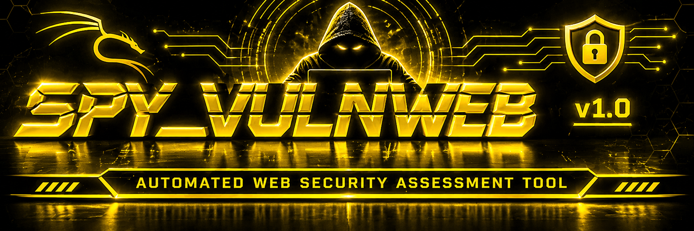

<p align="center">
  
</p>

# 🕵️ SPY_VULNWEB

<div align="right">

</div>

# SPY_VULNWEB

<p align="center">


</p>

### Automated Web Security Assessment Tool

A Kali Linux-exclusive Python-based web security assessment tool for identifying potential security misconfigurations, HTTP security issues, TLS problems, exposed services, and other web security indicators.

**CLI + GUI · JSON · HTML · PDF reports**

---

## 🚀 Features

- Automated web security assessment
- HTTP security header analysis
- TLS/SSL configuration checks
- Exposed service identification
- Security misconfiguration detection
- Structured security reports
- JSON and HTML report output
- PDF report generation

*Keep only the features that are implemented and tested in the current version.*

## 🛠️ Technology Stack

- Python 3
- Kali Linux
- HTTP/HTTPS
- TLS/SSL
- HTML
- JSON

## 1. Information Collected by SPY-VULNWEB

SPY-VULNWEB performs basic website security assessments by analyzing publicly accessible website information, HTTP/HTTPS responses, security configurations, and commonly exposed services.

The tool collects and examines the following information:

| Information | Description |
|---|---|
| **HTTP/HTTPS** | Checks website connectivity, HTTP/HTTPS availability, and server response behavior. |
| **SSL/TLS Certificate** | Examines SSL/TLS certificate validity, expiration dates, and basic certificate information. |
| **Security Headers** | Identifies missing or improperly configured HTTP security headers. |
| **Cookies** | Analyzes cookie security attributes, including `Secure`, `HttpOnly`, and `SameSite`. |
| **CORS Configuration** | Examines Cross-Origin Resource Sharing (CORS) policies for potentially insecure configurations. |
| **Open Ports** | Performs basic TCP connectivity checks against commonly used ports to identify accessible services. |
| **Technology Detection** | Identifies basic website technologies and server-related information exposed through public responses. |
| **API Documentation** | Checks commonly used API documentation paths for publicly accessible documentation or endpoints. |

## 2. Vulnerabilities and Security Issues Identified

SPY-VULNWEB is designed to identify potential website security weaknesses and misconfigurations through automated checks.

The following security issues are examined:

| Security Issue | Description |
|---|---|
| **Missing Security Headers** | Detects missing or improperly configured security headers, such as Content Security Policy (CSP) and HTTP Strict Transport Security (HSTS). |
| **Insecure Cookies** | Identifies cookies that may be missing important security attributes, including `Secure`, `HttpOnly`, or `SameSite`. |
| **Weak CORS Configuration** | Detects potentially unsafe CORS policies that may allow unauthorized cross-origin access. |
| **SSL/TLS Issues** | Identifies certificate-related issues, including invalid or expired SSL/TLS certificates. |
| **CSRF Indicators** | Checks for basic indicators of missing or insufficient Cross-Site Request Forgery (CSRF) protection. |
| **SQL Error Indicators** | Identifies database-related error messages exposed in HTTP responses that may reveal sensitive implementation details. |
| **Exposed Services** | Detects commonly used TCP ports that accept connections and may indicate publicly accessible services. |
| **API Exposure** | Identifies commonly used API documentation paths that are publicly accessible and may expose API information. |

## 3. Purpose and Scope

The primary purpose of SPY-VULNWEB is to help identify common website security misconfigurations and potential vulnerabilities through automated security checks.

It provides an initial overview of a website's security posture by examining publicly accessible information and configurations.

**Important:** SPY-VULNWEB is intended for basic security assessment and preliminary vulnerability identification. Its findings should not be considered definitive proof of exploitability. Further manual verification and in-depth security testing may be required to confirm identified issues.

## 4. Authorized Usage

SPY-VULNWEB should only be used to assess websites, servers, and applications that you own or have explicit permission to test.

Unauthorized security testing against third-party systems is not permitted. Always ensure that assessments are performed within an authorized scope.


## 💻 Platform Requirements

- Kali Linux
- Python 3
- pip
- Internet connection for authorized target assessments

## 📥 Installation

Clone the repository:

```bash
git clone https://github.com/hackwithspy/spy_vulnweb.git
```

Enter the project directory:

```bash
cd spy_vulnweb
```

Create a virtual environment:

```bash
python3 -m venv venv
source venv/bin/activate
```

Install dependencies:

```bash
pip install -r requirements.txt
```

## ▶️ Usage

Start the scanner:

```bash
python3 spy_vulnweb.py
```

When prompted, enter the URL of a system you own or have explicit authorization to test.

## 📊 Reports

The tool may generate reports in the following formats, depending on the implemented features:

- JSON
- HTML
- PDF

## 📁 Project Structure

```text
spy_vulnweb/

assets/
spy_reports/
spy_vulnweb.py
requirements.txt
README.md
LICENSE
.gitignore
```

*Update this tree to match the actual repository files. Do not publish private scan reports.*

<p align="center">


</p>

## 🔐 Authorized Testing Only

SPY_VULNWEB is intended for educational purposes, security research, and authorized security assessments.

Only scan systems for which you have explicit permission.

The developer is not responsible for unauthorized use or misuse of this software.

## 👨‍💻 Developer

- **GitHub:** [@hackwithspy](https://github.com/hackwithspy)
- **Instagram:** [@hacked_with_spy_](https://www.instagram.com/hacked_with_spy_/)
- **Project:** [SPY_VULNWEB](https://github.com/hackwithspy/spy_vulnweb)

---

⭐ If you find this project useful, consider giving it a star!

---

⭐ If you find this project useful, consider giving it a star!
